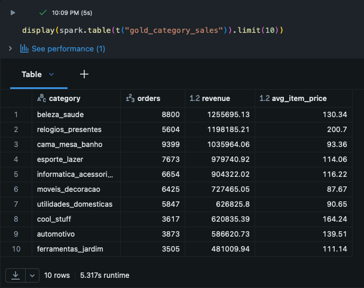

[Data Set](https://www.kaggle.com/datasets/olistbr/brazilian-ecommerce)

# Olist E-Commerce Data Pipeline

Data engineering project using Python, PySpark, and Databricks to build an end-to-end pipeline on about 100K Brazilian e-commerce orders, turning raw CSV files into clean, query-ready Delta tables using a bronze, silver, and gold architecture.

## Features

- Ingested 4 raw Kaggle CSV files (orders, order items, products, customers) into Delta tables with audit columns for load time and source file.
- Cleaned and standardized the data by fixing data types, removing duplicates, handling missing product categories, and joining everything into one order-line table.
- Engineered delivery metrics including delivery time in days and a late-delivery flag based on the estimated delivery date.
- Added automated data quality checks (null order IDs, negative prices, duplicate order lines, empty tables) that stop the pipeline if any check fails.
- Built 3 gold tables for analysis: daily sales, sales by product category, and delivery performance by state.
- Identified top product categories by revenue, order volume, and average item price.

## Technologies

- Data Engineering: Python, PySpark
- Platform: Databricks (Free Edition), Delta Lake
- Architecture: Medallion (Bronze, Silver, Gold)

## Pipeline

```
CSV files -> Bronze (raw) -> Silver (cleaned + joined) -> Gold (summary tables)
```

| Notebook | Layer | What it does |
|----------|-------|--------------|
| `bronze_ingest.py` | Bronze | Loads raw CSVs into Delta tables as-is |
| `silver_clean.py` | Silver | Cleans, joins, adds delivery metrics, runs quality checks |
| `gold_marts.py` | Gold | Builds the three summary tables |

## Results

Top product categories by revenue (category names are in Portuguese, as in the original data):



- Health and beauty (`beleza_saude`) had the highest revenue at roughly 1.26M across about 8,800 orders.
- Watches and gifts (`relogios_presentes`) ranked second with a similar revenue from far fewer orders, thanks to the highest average item price (about 200).
- Bed, table and bath (`cama_mesa_banho`) had the most orders (about 9,400) but a lower average price (about 93), placing it third in revenue.


